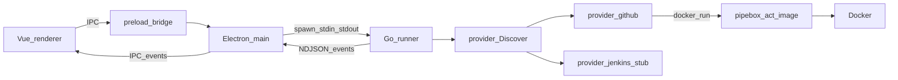

# PipeBox — agent notes

Local CI/CD desktop control panel: run CI workflows locally (GitHub Actions via **Dockerized act** today; Jenkins stub for later) so users can pick a repo, run workflows, inject secrets from project `.env` / `.env.*`, and watch step logs without pushing test commits.

v1 requires **Docker only** for GitHub — no local `act` binary.

## Architecture



Provider code lives under `packages/runner/internal/provider/`:

- `Discover` / `List` / `Resolve` — multi-provider; route runs per workflow
- `github/` — list/graph/run via act (moved from former `workflows` / `run` / `actparse` / `actimage`)
- `jenkins/` — empty stub (`Present` false); no real detection or run yet

The app renders a unified workflow list using `workflow.provider` (brand icons); it does not detect or parse CI files.

## MVP vs later

- **MVP:** GitHub Actions via Dockerized act, Electron UI, `pipebox` CLI, secrets from project `.env` / `.env.*`, provider seams + Jenkins stub.
- **Later:** Real Jenkins adapter, richer installers (Homebrew), code signing / notarization.

## Commands

```bash
pnpm app:start         # Electron app
pnpm runner:build      # Go CLI → packages/runner/pipebox
pnpm runner:test       # Go tests
pnpm runner:image      # build local pipebox-act Docker image
pnpm runner:lint       # golangci-lint
pnpm runner:lint:fix  # golangci-lint --fix
pnpm runner:doctor
```
