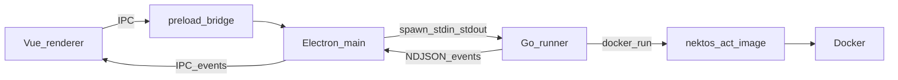

# PipeBox — agent notes

Local CI/CD desktop control panel: run GitHub Actions locally via **Dockerized act** (Jenkins later) so users can pick a repo, run workflows, inject secrets from project `.env` / `.env.*`, and watch step logs without pushing test commits.

v1 requires **Docker only** — no local `act` binary.

## Architecture



## MVP vs later

- **MVP:** GitHub Actions via Dockerized act, Electron UI, `pipebox` CLI, secrets from project `.env` / `.env.*`.
- **Later:** Jenkins adapter, richer installers (Homebrew), package runner into Forge release.

## Commands

```bash
pnpm app:start         # Electron app
pnpm runner:build      # Go CLI → packages/runner/pipebox
pnpm runner:test       # Go tests
pnpm runner:lint       # golangci-lint
pnpm runner:lint:fix  # golangci-lint --fix
pnpm runner:doctor
```
