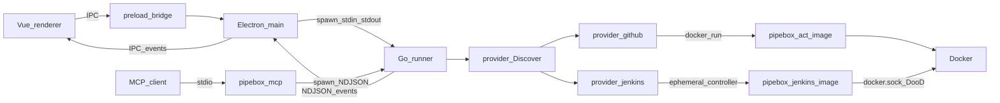

# PipeBox — agent notes

Local CI/CD desktop control panel: run CI workflows locally (GitHub Actions via **Dockerized act**; Jenkins via an **ephemeral official Jenkins controller**) so users can pick a repo, run workflows, inject secrets from project `.env` / `.env.*`, and watch step logs without pushing test commits.

v1 requires **Docker only** for both providers — no local `act` or Jenkins binary.

## Architecture

Provider code lives under `packages/runner/internal/provider/`:

- `Discover` / `List` / `Resolve` — multi-provider; route runs per workflow
- `github/` — list/graph/run via act (`actparse` / `actimage`; image from `packages/runner/docker/act`)
- `jenkins/` — list/graph via Declarative scan; run via ephemeral `jenkins/jenkins:lts-jdk21` (`pipebox-jenkins`), console streamed through `jfrparse`

The app renders a unified workflow list using `workflow.provider` (brand icons); it does not detect or parse CI files.

`packages/mcp` (`pipebox-mcp`) is an optional client of the runner — same boundary as Electron main. It must not reimplement providers; setup and tools: [packages/mcp/README.md](packages/mcp/README.md).

## MVP vs later

- **MVP:** GitHub Actions + ephemeral Jenkins (lean Casc/plugins, curated `agent any` toolchains, DooD docker agents), Electron UI, `pipebox` CLI, optional MCP for agents, secrets from project `.env` / `.env.*`.
- **Later:** Richer installers (Homebrew), code signing / notarization, DinD if DooD is insufficient, broader plugin packs.

## Commands

See [CONTRIBUTING.md](CONTRIBUTING.md).
