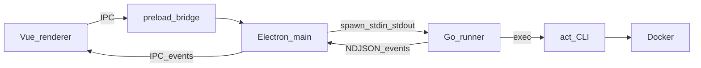

# PipeBox — agent notes

Local CI/CD desktop control panel: wrap **act** + Docker (Jenkins later) so users can pick a repo, run workflows, manage secrets, and watch step logs without pushing test commits.

## Architecture



## MVP vs later

- **MVP:** GitHub Actions via act, Electron UI, `pipebox` CLI, secrets in Electron main.
- **Later:** Jenkins adapter, richer installers (Homebrew), package runner into Forge release.

## Commands

```bash
pnpm app:start       # Electron app
pnpm runner:build    # Go CLI → packages/runner/pipebox
pnpm runner:lint       # golangci-lint
pnpm runner:lint:fix  # golangci-lint --fix
pnpm runner:doctor
```
