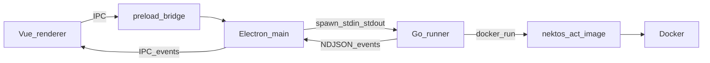

# PipeBox

Local CI/CD control panel for GitHub Actions: pick a repo, run workflows with Dockerized **act**, inject secrets from `.env` / `.env.*`, and watch step logs—without pushing test commits. Jenkins support comes later.

## Install

### Prerequisites

- **Go 1.22+** on `PATH` (for `go install`)
- **Docker** running (for `doctor` / `run`)
- After install, `$GOBIN` or `$GOPATH/bin` must be on your `PATH`

### Recommended — `go install`

```bash
go install github.com/MaxiGarcia13/pipebox/packages/runner/cmd/pipebox@latest
```

This installs the `pipebox` CLI into `$GOBIN` (or `$GOPATH/bin`). `@latest` resolves the newest `packages/runner/v*` release. Pin a version with `@v0.1.0` (module version—not the git tag path prefix).

The desktop app is separate: package it locally with `pnpm --filter @pipebox/app package`, install a future desktop release, or set `PIPEBOX_APP` to the Electron binary / `.app`. Then `pipebox` (or `pipebox --repo .`) opens the UI.

### Alternative — GitHub Release binary

1. Download the asset for your OS/arch from [Releases](https://github.com/MaxiGarcia13/pipebox/releases)
2. Put it on your `PATH`, or run `./pipebox install` to copy into a user bin dir
3. Verify with `pipebox --version` and `pipebox doctor`

### Alternative — build from source

```bash
pnpm runner:build
# or: make -C packages/runner build
./packages/runner/pipebox install   # optional: copy onto PATH
```

Local desktop: `pnpm start` (builds the runner, then launches Electron). After `pnpm --filter @pipebox/app package`, bare `pipebox` can find the app under `packages/app/out/`.

## CLI

```bash
pipebox                      # open desktop UI
pipebox --repo <path>        # open UI with that repo (e.g. --repo .)
pipebox --help | -h
pipebox --version | -v
pipebox version
pipebox doctor
pipebox list --repo <path>
pipebox graph --repo <path> --workflow <file>
pipebox run --repo <path> --workflow <file> [--job <id>] [--input KEY=VALUE] [--secret KEY=VALUE] [--secret-file <path>]
pipebox install
pipebox uninstall
```

`run` loads `.env` and any `.env.*` from the repo root (`.env` first, then alphabetical) when `--secret-file` is omitted. `install` copies the current binary into `~/.local/bin/pipebox`; `uninstall` removes that file.

Desktop lookup order: `PIPEBOX_APP`, platform defaults (e.g. `/Applications/PipeBox.app`), then a packaged monorepo build under `packages/app/out/`.

## Stack

| Package           | Role                     | Tech                                                                     |
| ----------------- | ------------------------ | ------------------------------------------------------------------------ |
| `packages/app`    | Desktop shell + UI       | Electron, Vue 3, Vite, Tailwind v4, [shadcn-vue](https://shadcn-vue.com) |
| `packages/runner` | CI runner + terminal CLI | Go binary `pipebox`                                                      |

## Architecture



The Go binary is both the app’s runner (spawned by Electron) and the CLI above.

## Develop

```bash
pnpm install
pnpm start
pnpm test
pnpm lint
pnpm runner:build
pnpm runner:test
pnpm runner:image
pnpm runner:lint
pnpm runner:lint:fix
pnpm runner:doctor
```

From `packages/runner`:

```bash
make build
./pipebox doctor
./pipebox list --repo /path/to/repo
```

See [AGENTS.md](AGENTS.md) for package boundaries and agent conventions.
