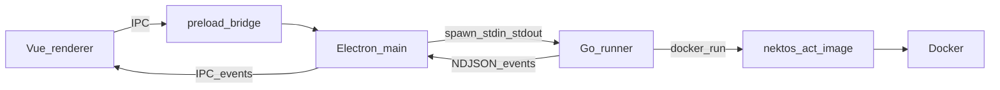

# PipeBox

Local CI/CD desktop control panel that wraps tools like **act** and Dockerized Jenkins into a clean visual interface. Select any local repository, trigger workflows or pipeline stages with one click, inject secrets from the project’s `.env` / `.env.*` files, and inspect real-time pass/fail step logs—without pushing test commits just to check YAML.

## Stack

| Package           | Role                     | Tech                                                                     |
| ----------------- | ------------------------ | ------------------------------------------------------------------------ |
| `packages/app`    | Desktop shell + UI       | Electron, Vue 3, Vite, Tailwind v4, [shadcn-vue](https://shadcn-vue.com) |
| `packages/runner` | CI runner + terminal CLI | Go binary `pipebox`                                                      |

Requires **Docker** only for local GitHub Actions runs (PipeBox builds a local `pipebox-act` image with the official act binary — no local `act` install). Jenkins support comes later.

## Architecture



The Go binary is both the app’s runner (spawned by Electron) and a **CLI** you can install on your `PATH`.

## CLI

```bash
pipebox doctor
pipebox list --repo <path>
pipebox run --repo <path> --workflow <file>
pipebox install
```

`run` loads `.env` and any `.env.*` files from the repo root (`.env` first, then alphabetical). Override with `--secret KEY=VALUE` or `--secret-file <path>`.

## Develop

```bash
pnpm install
pnpm app:start
pnpm runner:build
pnpm runner:test
pnpm runner:image
pnpm runner:lint
pnpm runner:lint:fix
pnpm runner:doctor
```

Or from `packages/runner`:

```bash
make build
./pipebox doctor
./pipebox list --repo /path/to/repo
```

See [AGENTS.md](AGENTS.md) for package boundaries and agent conventions.
