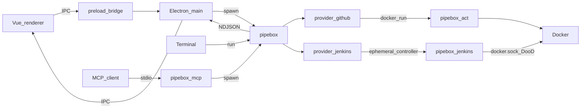

# PipeBox

Local CI/CD for GitHub Actions and Jenkins — run and debug pipelines from the desktop UI, terminal, or MCP. No git push required.


| Provider       | Status                                                                                                                                |
| -------------- | ------------------------------------------------------------------------------------------------------------------------------------- |
| GitHub Actions | Ready — run locally via Dockerized [act](https://github.com/nektos/act) (`pipebox-act`)                                               |
| Jenkins        | Ready — run locally via an ephemeral [Jenkins LTS](https://www.jenkins.io/doc/book/installing/docker/) controller (`pipebox-jenkins`) |

## What you get

- Browse GitHub Actions and Jenkins workflows for a local repo
- Run jobs with Dockerized act / ephemeral Jenkins (no host `act` or Jenkins binary)
- Inject secrets from `.env` / `.env.*`
- Live step logs in the desktop UI — or pure CLI (`list` / `graph` / `run`)
- Optional MCP server for AI agents (skinny run summaries + step log tails)

## How it works

| Package           | Role                     | Tech                                                                     |
| ----------------- | ------------------------ | ------------------------------------------------------------------------ |
| `packages/app`    | Desktop shell + UI       | Electron, Vue 3, Vite, Tailwind v4, [shadcn-vue](https://shadcn-vue.com) |
| `packages/runner` | CI runner + terminal CLI | Go binary `pipebox`                                                      |
| `packages/mcp`    | MCP server for agents    | Go binary `pipebox-mcp` (stdio; wraps the CLI)                           |



## Quick start

**Needs:** Docker running · Go 1.22+ on `PATH`

Desktop platforms: [packages/app/README.md#support](packages/app/README.md#support).

Install the CLI:

```bash
go install github.com/MaxiGarcia13/pipebox/packages/runner/cmd/pipebox@latest
```

Install the desktop app:

```bash
pipebox install-desktop
```

Check setup:

```bash
pipebox doctor
```

Open the UI:

```bash
pipebox
```

Or download the CLI binary for your OS/arch from [Releases](https://github.com/MaxiGarcia13/pipebox/releases) and put it on your `PATH`.

## CLI

Open the desktop UI (reuse if already running). If this directory has GitHub Actions or Jenkins workflows, that project opens. Otherwise the app starts with no project.

```bash
pipebox
```

Open / switch to a repo:

```bash
pipebox --repo <path>
```

Open a new window:

```bash
pipebox -n --repo <path>
```

Show help:

```bash
pipebox --help
```

Print the CLI version:

```bash
pipebox --version
```

Check Docker and local setup:

```bash
pipebox doctor
```

List workflows in the repo you are in. A terminal prints a table. An empty repo prints `no workflows`.

```bash
pipebox list
```

```
PROVIDER  NAME   PATH
github    CI     .github/workflows/ci.yml
jenkins   Build  Jenkinsfile
```

Pipe stdout when you want one JSON object:

```bash
pipebox list | jq
```

List a different checkout:

```bash
pipebox list --repo ~/src/other
```

Show jobs and steps before a run. Each job is an id and a name. A job that waits on another includes `needs`, and its steps are indented under it. Pass `--provider github` or `--provider jenkins` only when the same path could match both.

```bash
pipebox graph --workflow .github/workflows/ci.yml
```

```
lint   Lint
  echo ok
build  Build
  needs: lint
  npm test
```

Run a workflow. The command streams NDJSON on purpose; the desktop app is the live view.

```bash
pipebox run --workflow .github/workflows/ci.yml
```

Run a single job:

```bash
pipebox run --workflow .github/workflows/ci.yml --job lint
```

Pass a `workflow_dispatch` input. Repeat `--input` for more than one.

```bash
pipebox run --workflow .github/workflows/ci.yml --input name=value
```

Secrets load from `.env` and `.env.*` in the repo. Pass `--secret KEY=VALUE` or `--secret-file path/to/file` to override that.

Pipes and the desktop app always get NDJSON. There is no `--json` flag. A terminal gets the table for `list` and `graph` only.

## MCP (agents)

Use PipeBox from Cursor, Claude Desktop, or any MCP-capable agent without dumping full CI logs into the model:

```bash
pipebox install-mcp
```

Then add `pipebox-mcp` as a stdio MCP server in your client. Setup, tools, and the preferred agent loop: [packages/mcp/README.md](packages/mcp/README.md).

Run the MCP server (stdio) directly:

```bash
pipebox mcp
```

## Updates

Check for a newer release:

```bash
pipebox update --check
```

Install the latest CLI (desktop and MCP only if already installed):

```bash
pipebox update
```

Pin a version:

```bash
pipebox update --version 0.4.1
```

No second `go install` needed once a `pipebox` binary is on your `PATH`.

Or run `pipebox install` to copy the CLI into `~/.local/bin/pipebox` and fetch the desktop app in one go.

Remove the local CLI install, desktop app, and MCP (if present):

```bash
pipebox uninstall
```

## Notes

### GitHub

GitHub `actions/cache` and `actions/upload-artifact` run locally via act’s servers so those steps don’t fail. Cache is ephemeral per run (not GitHub’s cloud cache, not shared across PipeBox runs). Artifacts are collected for the UI/CLI after the run; they are not uploaded to GitHub.

### CLI

Enable tab completion once in your shell config:

**zsh** — add to `~/.zshrc`:

```bash
eval "$(pipebox completion zsh)"
```

**bash** — add to `~/.bashrc`:

```bash
eval "$(pipebox completion bash)"
```

**fish**:

```fish
pipebox completion fish > ~/.config/fish/completions/pipebox.fish
```

Then open a new terminal tab (or `source` your rc file).

## Develop

See [CONTRIBUTING.md](CONTRIBUTING.md).
