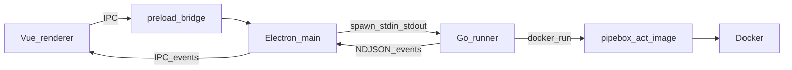

# PipeBox

Local CI/CD control panel for GitHub Actions: pick a repo, run workflows with Dockerized **act**, inject secrets from `.env` / `.env.*`, and watch step logs—without pushing test commits. Jenkins support comes later.

## Install

### Prerequisites

- **Go 1.22+** on `PATH` (for `go install`)
- **Docker** running (for `doctor` / `run`)

### 1. CLI

```bash
go install github.com/MaxiGarcia13/pipebox/packages/runner/cmd/pipebox@latest
```

Puts `pipebox` on your `PATH` (`$GOBIN` or `$GOPATH/bin`). `@latest` resolves the newest `packages/runner/v*` release. Pin with `@v0.1.0` (module version—not the git tag path prefix).

Or download the CLI binary for your OS/arch from [Releases](https://github.com/MaxiGarcia13/pipebox/releases) and put it on your `PATH`.

### 2. Desktop app

```bash
pipebox install-desktop
```

Downloads the matching desktop app from [Releases](https://github.com/MaxiGarcia13/pipebox/releases) into a user-local folder (no admin/sudo).

Or run `pipebox install` to copy the CLI into `~/.local/bin/pipebox` and fetch the desktop app in one go.

### 3. Later updates

```bash
pipebox update              # download latest CLI release → ~/.local/bin + desktop
pipebox update --check      # report whether a newer release exists
pipebox update --version 0.4.1
```

No second `go install` needed once a `pipebox` binary is on your `PATH`.

### Verify

```bash
pipebox doctor
pipebox                 # open desktop UI (reuse if already running)
pipebox --repo .        # open UI with this repo
pipebox -n --repo .     # open a new window with this repo
```

Builds are unsigned for now. On macOS, if Gatekeeper blocks the app: right-click `PipeBox.app` → Open → Open. On Windows, accept the SmartScreen prompt if shown.

Desktop lookup order: `PIPEBOX_APP`, user install (`~/Applications/PipeBox.app`, `%LOCALAPPDATA%\PipeBox\PipeBox.exe`, `~/.local/share/pipebox-app/PipeBox`), system installs (`/Applications`, `/opt/pipebox-app`), then a packaged monorepo build under `packages/app/out/`.

## CLI

```bash
pipebox                      # open desktop UI (reuse if already running)
pipebox --repo <path>        # open / switch to that repo (e.g. --repo .)
pipebox -n | --new [--repo <path>]  # new window instead of reusing
pipebox --help | -h
pipebox --version | -v
pipebox version
pipebox doctor
pipebox list --repo <path>
pipebox graph --repo <path> --workflow <file>
pipebox run --repo <path> --workflow <file> [--job <id>] [--input KEY=VALUE] [--secret KEY=VALUE] [--secret-file <path>]
pipebox install              # CLI → ~/.local/bin + fetch desktop
pipebox install-desktop      # fetch desktop only
pipebox update [--check] [--version <v>]  # fetch latest (or pinned) CLI + desktop
pipebox uninstall
```

## Stack

| Package           | Role                     | Tech                                                                     |
| ----------------- | ------------------------ | ------------------------------------------------------------------------ |
| `packages/app`    | Desktop shell + UI       | Electron, Vue 3, Vite, Tailwind v4, [shadcn-vue](https://shadcn-vue.com) |
| `packages/runner` | CI runner + terminal CLI | Go binary `pipebox`                                                      |

## Architecture



The Go binary is both the app’s runner (spawned by Electron) and the CLI above. Provider discovery and boundaries: [AGENTS.md](AGENTS.md).

## Develop

See [CONTRIBUTING.md](CONTRIBUTING.md).
