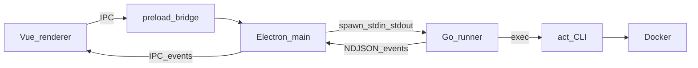

# PipeBox

Local CI/CD desktop control panel that wraps tools like **act** and Dockerized Jenkins into a clean visual interface. Select any local repository, trigger workflows or pipeline stages with one click, manage local secrets safely, and inspect real-time pass/fail step logs—without pushing test commits just to check YAML.

## Stack

| Package           | Role                     | Tech                                                                     |
| ----------------- | ------------------------ | ------------------------------------------------------------------------ |
| `packages/app`    | Desktop shell + UI       | Electron, Vue 3, Vite, Tailwind v4, [shadcn-vue](https://shadcn-vue.com) |
| `packages/runner` | CI runner + terminal CLI | Go binary `pipebox`                                                      |

Requires **Docker** and **act** on the machine for local GitHub Actions runs. Jenkins support comes later.

## Architecture



The Go binary is both the app’s runner (spawned by Electron) and a **CLI** you can install on your `PATH`.

## CLI (planned)

```bash
pipebox doctor
pipebox list --repo <path>
pipebox run --repo <path> --workflow <file>
pipebox install
```

## Develop

```bash
pnpm install
pnpm app:start
```

Runner build (once `packages/runner` exists):

```bash
cd packages/runner
go build -o pipebox .
./pipebox doctor
```

See [AGENTS.md](AGENTS.md) for package boundaries and agent conventions.
