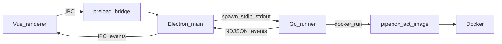

# PipeBox

Local CI/CD control panel — desktop UI + CLI. Secrets from `.env`. No push required.


Run CI workflows locally with Dockerized [act](https://github.com/nektos/act), inject secrets from `.env` / `.env.*`, and watch step logs — without pushing test commits.

| Provider       | Status                                       |
| -------------- | -------------------------------------------- |
| GitHub Actions | Ready — run locally via Dockerized act       |
| Jenkins        | In progress — adapter stub, not runnable yet |

## Quick start

**Needs:** Docker running · Go 1.22+ on `PATH`

Install the CLI:

```bash
go install github.com/MaxiGarcia13/pipebox/packages/runner/cmd/pipebox@latest
```

Install the desktop app:

```bash
pipebox install-desktop
```

Check setup:

```bash
pipebox doctor
```

Open the UI on this repo:

```bash
pipebox --repo .
```

Or download the CLI binary for your OS/arch from [Releases](https://github.com/MaxiGarcia13/pipebox/releases) and put it on your `PATH`.

Builds are unsigned for now. On macOS, if Gatekeeper blocks the app: right-click `PipeBox.app` → Open → Open. On Windows, accept the SmartScreen prompt if shown.

## What you get

- Browse workflows for a local repo
- Run jobs with Dockerized act (no local `act` binary)
- Inject secrets from `.env` / `.env.*`
- Live step logs in the desktop UI — or pure CLI (`list` / `graph` / `run`)

## Updates

Check for a newer release:

```bash
pipebox update --check
```

Install the latest CLI + desktop:

```bash
pipebox update
```

Pin a version:

```bash
pipebox update --version 0.4.1
```

No second `go install` needed once a `pipebox` binary is on your `PATH`.

Or run `pipebox install` to copy the CLI into `~/.local/bin/pipebox` and fetch the desktop app in one go.

## CLI

Open the desktop UI (reuse if already running):

```bash
pipebox
```

Open / switch to a repo:

```bash
pipebox --repo <path>
```

Open a new window:

```bash
pipebox -n --repo <path>
```

Other commands:

```bash
pipebox --help
```

```bash
pipebox --version
```

```bash
pipebox doctor
```

```bash
pipebox list --repo <path>
```

```bash
pipebox graph --repo <path> --workflow <file>
```

```bash
pipebox run --repo <path> --workflow <file> [--job <id>] [--input KEY=VALUE] [--secret KEY=VALUE] [--secret-file <path>]
```

```bash
pipebox install
```

```bash
pipebox install-desktop
```

```bash
pipebox update [--check] [--version <v>]
```

```bash
pipebox uninstall
```

```bash
pipebox completion zsh
```

(`completion` also supports `bash` and `fish`. `pipebox install` / `pipebox update` write completion scripts automatically.)

## How it works

| Package           | Role                     | Tech                                                                     |
| ----------------- | ------------------------ | ------------------------------------------------------------------------ |
| `packages/app`    | Desktop shell + UI       | Electron, Vue 3, Vite, Tailwind v4, [shadcn-vue](https://shadcn-vue.com) |
| `packages/runner` | CI runner + terminal CLI | Go binary `pipebox`                                                      |



The Go binary is both the app’s runner (spawned by Electron) and the CLI above. Provider discovery and boundaries: [AGENTS.md](AGENTS.md).

## Develop

See [CONTRIBUTING.md](CONTRIBUTING.md).
