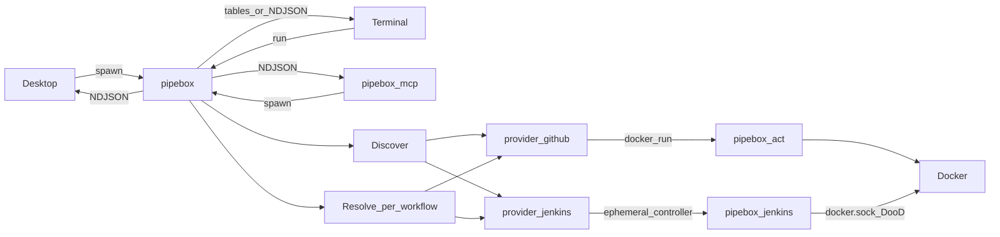

# PipeBox runner

Go binary `pipebox` — multi-provider CI runner and public CLI. Shared by the Electron app and `pipebox-mcp`.

## How it works

Discovers providers per repo (`Discover` / `List` / `Resolve`), then routes `graph` / `run` **per selected workflow** via `provider` (or `--provider`).

| Provider       | Execution                                                       |
| -------------- | --------------------------------------------------------------- |
| GitHub Actions | Dockerized act (`pipebox-act` from `docker/act`)                |
| Jenkins        | Ephemeral `pipebox-jenkins` controller (`docker/jenkins`, DooD) |

v1 needs Docker only. Secrets load from the repo’s `.env` / `.env.*`. Machines get NDJSON on stdout; interactive terminals get tables for `list` / `graph`.

## Protocol (v1)

Event types: `workflow_list`, `run_started`, `run_finished`, `job_graph`, `step_started`, `step_finished`, `log`, `error`, `artifacts`, `doctor`.

App mirror: `packages/app/src/domain/runner-events.ts` (keep in sync when the Go shape changes).

## Related

- [packages/app/README.md](../app/README.md)
- [packages/mcp/README.md](../mcp/README.md)
- [README.md](../../README.md) (CLI)
- [CONTRIBUTING.md](../../CONTRIBUTING.md)
